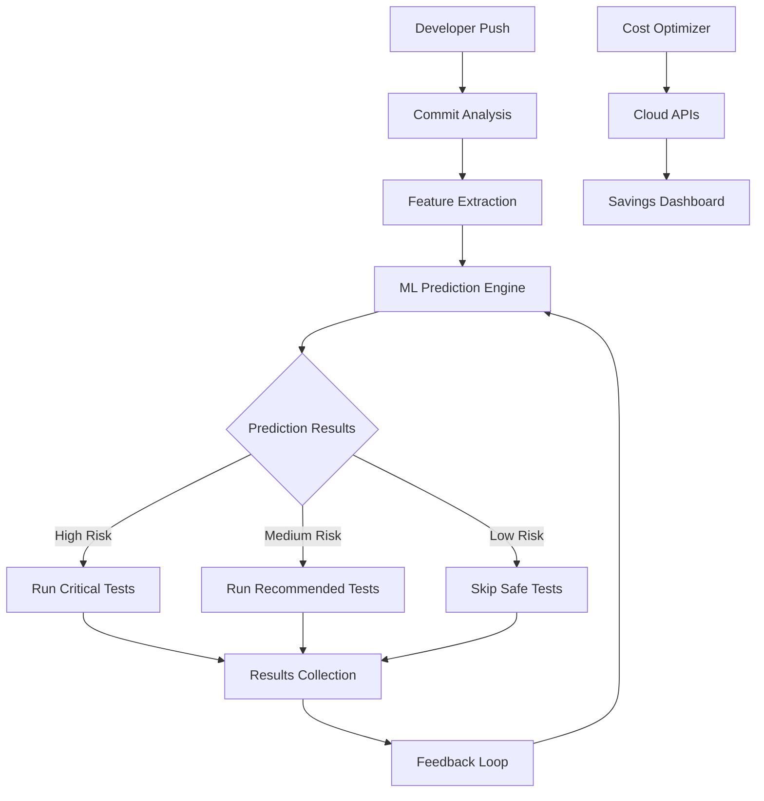

# 🚀 Predictive Test Selection (PTS)

**Enterprise-grade CI/CD optimization with machine learning.**

<div align="center">

[](https://github.com/Amir032-cyber/AI-Optimized-Massive-Scale-CI-CD/actions/workflows/ci.yml)
[](LICENSE)
[](https://github.com/Amir032-cyber/AI-Optimized-Massive-Scale-CI-CD/issues)
[](https://github.com/Amir032-cyber/AI-Optimized-Massive-Scale-CI-CD/stargazers)
[](https://www.python.org/)
[](https://www.docker.com/)
[](https://kubernetes.io/)

[📚 Documentation](#-documentation) · [🚀 Quick Start](#-quick-start) · [💡 Examples](#-examples) · [🤝 Contributing](#-contributing)

</div>

> Reduce CI/CD costs by 50%+ while maintaining high defect-detection coverage through intelligent test selection.

## ✨ Features

- 🎯 **Intelligent test prediction** with [XGBoost](https://xgboost.readthedocs.io/) and ensemble models.
- ⚡ **Faster CI feedback** by selecting the tests most relevant to each change.
- 💰 **Cost and carbon optimization** with ROI tracking and cloud metrics.
- 🔌 **CI/CD integrations** for [GitHub Actions](https://docs.github.com/en/actions), [GitLab CI](https://docs.gitlab.com/ee/ci/), [Jenkins](https://www.jenkins.io/), [CircleCI](https://circleci.com/), and [Azure DevOps](https://azure.microsoft.com/products/devops).
- 🌍 **Multi-cloud support** for [AWS](https://aws.amazon.com/), [Google Cloud](https://cloud.google.com/), and [Microsoft Azure](https://azure.microsoft.com/).
- 🛡️ **Enterprise-ready** security, audit logging, and compliance workflows.
- 📊 **Analytics** for test flakiness, duration, failure rates, and historical trends.

## 🏗️ Architecture



## 🚀 Quick Start

### Installation

```bash
# From PyPI, when the package is published
pip install predictive-test-selection

# Or clone this repository
 git clone https://github.com/Amir032-cyber/AI-Optimized-Massive-Scale-CI-CD.git
cd AI-Optimized-Massive-Scale-CI-CD
pip install -e ".[dev]"
```

### Docker

```bash
docker build -t predictive-test-selection .
docker run --rm -p 8080:8080 predictive-test-selection
```

### Python usage

```python
from predictive_test_selection import PTSClient

client = PTSClient(
    model_type="xgboost",
    confidence_threshold=0.001,
    cache_enabled=True,
)

client.train(
    repository_path="./your-project",
    lookback_days=90,
    test_framework="pytest",
)

predictions = client.predict(
    commit_hash="abc123",
    changed_files=["src/module.py"],
)

if predictions.selected_tests:
    run_tests(predictions.selected_tests)
```

## 🔗 GitHub Actions

Add this workflow to `.github/workflows/smart-ci.yml`:

```yaml
name: Intelligent CI/CD

on: [push, pull_request]

jobs:
  smart-testing:
    runs-on: ubuntu-latest
    steps:
      - uses: actions/checkout@v4

      - name: Predictive Test Selection
        uses: Amir032-cyber/predictive-test-selection-action@v2
        with:
          model: xgboost-v3
          threshold: 0.001
          token: ${{ secrets.GITHUB_TOKEN }}

      - name: Run selected tests
        run: |
          if [ -f selected_tests.txt ]; then
            python -m pytest $(cat selected_tests.txt) --junitxml=results.xml
          else
            python -m pytest --junitxml=results.xml
          fi
```

## 📊 Performance Metrics

| Metric | Before PTS | With PTS | Improvement |
|---|---:|---:|---:|
| Test execution time | 45 min | 9 min | ⏱️ 80% faster |
| Cloud costs | $100k/month | $45k/month | 💰 55% savings |
| CPU hours | 10,000 hrs | 4,500 hrs | 🌿 55% reduction |
| Developer wait time | 30+ min | <5 min | 🚀 85% faster feedback |
| Carbon emissions | 120 tCO₂e | 54 tCO₂e | 🌍 55% reduction |

## 🔌 Integration Ecosystem

| Platform | Status | Link |
|---|---|---|
| [GitHub Actions](https://docs.github.com/en/actions) | ✅ Production | [Action](https://github.com/Amir032-cyber/predictive-test-selection-action) |
| [GitLab CI](https://docs.gitlab.com/ee/ci/) | ✅ Production | `pts-gitlab` |
| [Jenkins](https://www.jenkins.io/) | ✅ Production | `pts-jenkins` |
| [CircleCI](https://circleci.com/) | ✅ Beta | `pts-orb` |
| [Azure DevOps](https://azure.microsoft.com/products/devops) | ✅ Production | `pts-azure` |
| Bitbucket | 🚧 Alpha | Coming soon |

## 💡 Examples

- [GitHub Actions examples](examples/github_actions/)
- [GitLab CI example](examples/gitlab_ci/)
- [Jenkins example](examples/jenkins/)
- [Model configuration](configs/model_config.yaml)
- [API configuration](configs/api_config.yaml)

## 📚 Documentation

- [Documentation home](docs/index.md)
- [Getting started](docs/getting_started.md)
- [API reference](docs/api_reference.md)
- [Deployment guide](docs/deployment_guide.md)
- [Contributing guide](docs/contributing.md)
- [Project issues](https://github.com/Amir032-cyber/AI-Optimized-Massive-Scale-CI-CD/issues)
- [Pull requests](https://github.com/Amir032-cyber/AI-Optimized-Massive-Scale-CI-CD/pulls)
- [CI workflow runs](https://github.com/Amir032-cyber/AI-Optimized-Massive-Scale-CI-CD/actions)

## 🛠️ Development

```bash
pytest tests/ -v --cov=predictive_test_selection
pre-commit run --all-files
mkdocs build
```

## 🤝 Contributing

Contributions are welcome. Please read the [contributing guide](docs/contributing.md), open an [issue](https://github.com/Amir032-cyber/AI-Optimized-Massive-Scale-CI-CD/issues/new/choose), or submit a [pull request](https://github.com/Amir032-cyber/AI-Optimized-Massive-Scale-CI-CD/compare).

## 📄 License

This project is licensed under the [Apache License 2.0](LICENSE).

## 📞 Contact & Support

- 🐛 [GitHub Issues](https://github.com/Amir032-cyber/AI-Optimized-Massive-Scale-CI-CD/issues)
- 📧 `Shadow_net.org@proton.me`
- 🐦 [@ai_pts on Twitter/X](https://twitter.com/ai_pts)
- 📱 WhatsApp: `+226 02688902`

<div align="center">

Made with ❤️ by [Amir032-cyber](https://github.com/Amir032-cyber) and [contributors](https://github.com/Amir032-cyber/AI-Optimized-Massive-Scale-CI-CD/graphs/contributors)

[](https://github.com/Amir032-cyber/AI-Optimized-Massive-Scale-CI-CD/stargazers)
[](https://github.com/Amir032-cyber/AI-Optimized-Massive-Scale-CI-CD/network/members)
[](https://github.com/Amir032-cyber/AI-Optimized-Massive-Scale-CI-CD/issues)

</div>

> Predictive Test Selection is not officially associated with Google, Meta, or any other company mentioned. All trademarks belong to their respective owners.
